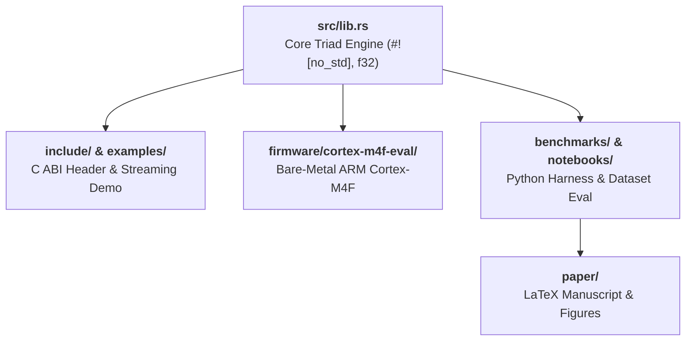
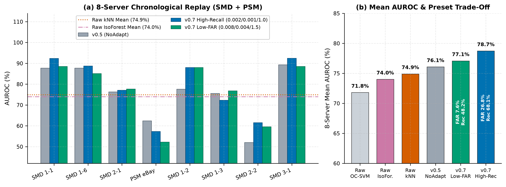

# PPC-Gauge-Triad v0.7.1 (`ppc_gauge_triad_rs`)

[](https://github.com/Imlevion/ppc-gauge-triad/actions/workflows/ci.yml)
[](https://crates.io/crates/ppc_gauge_triad_rs)
[](https://docs.rs/ppc_gauge_triad_rs)
[](LICENSE-MIT)

Deterministic, zero-heap (`#![no_std]`), zero-matrix-inversion Rust (`f32`) streaming anomaly engine with an on-chip Zero-Touch Auto-Warmup state machine (`AutoCalBufF32`: `Warmup -> Calibrate -> Monitor`) for multi-channel telemetry and embedded physical sensors ($X_t \in \mathbb{R}^{w \times d}$, default $w=8, d=4$).

## Architecture Overview



### Visual Benchmark Highlights (Verified Offline Level 2 Replay, No Point-Adjust)


*Figure 1 — Real-world 8-server chronological replay (SMD + PSM, window-level `w = 8`, **strictly without point-adjust**, panel (b) y-axis starting at 50 with across-server `mean ± std`): **v0.7 High-Recall** reaches **78.7 ± 13.0%** AUROC (`26.8 ± 24.9%` Dual-Gate FAR) and **v0.7 Low-FAR** reaches **77.1 ± 13.1%** AUROC with the lowest Dual-Gate FAR (**7.6 ± 7.2%**) inside `< 16 KB` `#![no_std]` static struct SRAM (`0 B` heap, `0` matrix inversions). On raw 8-server mean AUROC under the same windowing, three heavier host-RAM baselines score higher: **PCA+Mahalanobis (Full-D)** (`80.9 ± 10.7%`, `43.3%` FAR), **RS-Hash** (`80.1 ± 15.0%`, `17.8%` FAR), and **kNN (32-D)** (`79.0 ± 11.0%`, `49.0%` FAR), while **Isolation Forest (32-D)** ties closely (`78.5 ± 11.0%`, `50.9%` FAR). Full per-server tables and raw-vs-gated FAR comparisons are in [`benchmarks/results_baselines.md`](benchmarks/results_baselines.md).*


*Figure 2 — v0.7 On-Chip Zero-Touch Auto-Warmup (`AutoCalEngineF32`, **14,744 B / 14.40 KB** static SRAM on ARM Cortex-M4F): pure zero-shot cross-device transfer scores **29.7%** mean AUROC (< 50%, indicating **inverted anomaly score direction** across heterogeneous servers rather than random guessing), whereas unsupervised on-chip `Warmup -> Calibrate -> Monitor` (`100–400` normal windows, `0` labels) recovers **75.3% → 82.9%** mean AUROC.*

> Reproduce all publication figures (`fig1`, `fig2`, and `fig3` 50k-window Dual-Stage Alarm Gate FAR reduction `10.44% -> 0.30%`) locally via `python benchmarks/generate_paper_figures.py --offline`, and the full baseline report via `python benchmarks/run_benchmarks.py --baselines --offline`.

## Validation Status

### Automated CI vs. Local Reproducible Research Benchmarks

| Verification Layer | Execution Mode | Scope Covered | Status |
| :--- | :--- | :--- | :--- |
| **Automated GitHub CI** (`.github/workflows/ci.yml`) | Runs on every push / PR (`ubuntu-latest` & `windows-latest`) | Rust Level 1 invariants (`L1.1–L1.9`, incl. 1M-window live stream) & `AutoCalBufF32` tests (`19` tests), Rustdoc `-D warnings`, doctests (`2/2`), C99 ABI demo (`gcc -Wall -Wextra -Werror -std=c99`), Python unit + `L1.8` parity tests, `cargo package`, Criterion compile check, **5-target cross-compilation**, and **Level 2.5 Cortex-M4F linked `.elf` + live QEMU execution** (`mps2-an386`). *Does not download/replay full SMD/PSM datasets on CI runners.* | **PASS** |
| **Local Reproducible Research Benchmarks** (`benchmarks/`) | Reproduced locally from cached offline `.npz` datasets (`--all --offline`) | 8-server chronological SMD + PSM replay (**window-level `w=8`, no point-adjust**): `78.7 ± 13.0%` High-Recall / `77.1 ± 13.1%` Low-FAR at `7.6 ± 7.2%` Dual-Gate FAR, fair streaming & batch baselines ([`benchmarks/results_baselines.md`](benchmarks/results_baselines.md)), Test 3B on-chip Auto-Warmup curve (`29.7%` 0w → `82.9%` 400w), Test 5 50k-window 5-seed streaming (`0.30% ± 0.13%` FAR, `100.0%` recall), OpenML physical/trajectory benchmarks, Criterion host CPU timings, and 300-DPI paper figures (`generate_paper_figures.py`). | **VERIFIED (Level 2)** |
| **Linked Cortex-M4F `.elf` & QEMU Proof (Level 2.5)** | Turnkey bare-metal crate (`firmware/cortex-m4f-eval/`, automated in CI) | Real linked `thumbv7em-none-eabihf` `.elf` (`cortex-m-rt` + `panic-halt` + `ppc_gauge_triad_rs` `default-features = false`): **Total Flash `23,624 B` (`23.07 KB`)**, **`.data = 0 B`**, **Total Static RAM `.bss = 14,784 B` (`14.44 KB`)**, plus live functional ARMv7E-M FPU execution (`400w` Auto-Warmup + fault trip) on QEMU `mps2-an386`. *Emulation is functional proof only — never silicon cycle timing.* | **VERIFIED (Level 2.5)** |
| **Physical Hardware Verification (Level 3)** | Real MCU/FPGA silicon (`firmware/cortex-m4f-eval/`, Issue [#3](https://github.com/Imlevion/ppc-gauge-triad/issues/3)) | Physical DWT cycle counts (`DWT_CYCCNT`), board-clock µs latency, full target-board `.map`, inline mW power profiling, and real IMU/thermal sensor streams via `probe-rs` / `defmt`. | **PENDING** |

See [`VALIDATION_REPORT_v061.md`](VALIDATION_REPORT_v061.md) for the complete evidence table and [`AGENTS.md`](AGENTS.md) for strict engineering rules and roadmap milestones.

### `#![no_std]` Embedded Integration & Memory Scope

- **Library vs. Final Firmware (`#[panic_handler]`):** Adding `ppc_gauge_triad_rs = { version = "0.7.1", default-features = false }` compiles a pure `#![no_std]` Rust library (`rlib`) **without** defining a `#[panic_handler]`. Your final bare-metal firmware binary **must** provide its own `#[panic_handler]` (e.g., `panic-halt`, `panic-probe`, or `panic-rtt-target`) and runtime startup/FPU initialization — avoiding duplicate `panic_impl` linker conflicts. Enable the opt-in `panic-handler` Cargo feature *only* when building a standalone `#![no_std]` `cdylib` outside a Rust firmware binary.
- **Engine Struct SRAM (`< 16 KB`) vs. Total Firmware RAM:** The compile-time assertions verify **only the engine's static `.bss` struct size** (`11,604 B` core / `14,744 B` `AutoCalEngineF32` on ARM Cortex-M4F, `0 B` heap). This does **not** guarantee that a complete user firmware fits within `16 KB` RAM — final firmware RAM sizing must also budget call stack (including a `1,024 B` stack scratch array during `finalize_calibration()`), interrupt/ISR frames, DMA/ADC/sensor ring buffers, logging buffers, and BSP/RTOS runtime overhead measured on the final `.elf`/`.map`.

---

## Architecture Highlights

1. **`s_shape` (Canonical Shape):** Orthonormal temporal DCT-II projection + explicit $2 \times 2$ Givens-QR canonicalization on $Sim^+(d)$ ($\det = +1$), scored via a symmetrized $K$-prototype rank-1 Sherman-Morrison precision bank ($K \le 4$, `0` matrix inversions, `0` stored training samples).
2. **Orthogonal PCA Residual Feature (`3PC + 1 Residual Norm`):** Maps high-dimensional telemetry ($D > 4$, e.g. 38-channel servers) into $d=4$ with `0` extra struct SRAM by placing the standardized orthogonal residual norm in channel 4.
3. **`s_energy` & `s_level` (Dual-Mode Environmental Tracking):**
   - **Server Telemetry Mode (`huber_clip > 0`):** Huber-clamped EMA tracks slow normal drift without swallowing sustained 50–300 window incidents.
   - **Thermal / Sensor Chip Mode (`huber_clip = 0, dc_relock = 6`):** Fast ramp EMA + 3-window energy hysteresis + stable-plateau DC re-lock.
4. **Dual-Stage Alarm Gate (`step_v61`):** Immediate trip on severe faults (`> 2.5x thr`) OR 2-consecutive-window confirmation.
5. **On-Chip Zero-Touch Auto-Warmup (`AutoCalBufF32` / `AutoCalEngineF32` — v0.7):** Fixed-size `#![no_std]` state machine (`Warmup -> Calibrate -> Monitor`, `MAX_CAL = 256`) that computes split-conformal thresholds and log1p-MAD triad normalizers directly on chip (`~14.4 KB` combined SRAM, enforced `< 16 KB` at compile time, `0 B` heap).

### Operational Presets & Preset Provenance

| Preset | `e_alpha` | `dc_alpha` | `huber_clip` | `dc_relock` | Intended Use |
| :--- | :---: | :---: | :---: | :---: | :--- |
| **High-Recall / Max-AUROC** | `0.002` | `0.001` | `1.0` | `0` | Server telemetry screening (`3PC+Resid`) |
| **Low-FAR Monitoring** | `0.008` | `0.004` | `1.5` | `0` | Low-alert-fatigue server monitoring (`3PC+Resid`) |
| **Thermal / Sensor Chip** | `0.20` | `0.25` | `0.0` | `6` | Embedded sensors under thermal ramps & regime steps |

#### Preset Provenance (Honest Git Audit)
- **What Git history cannot prove:** These presets were developed interactively in Google Colab (`notebooks/`, archived in commit `33cc3523`) and imported into this GitHub repository **simultaneously** with the initial SMD/PSM validation report (`VALIDATION_REPORT_v061.md`, commit `ba1a5068`, `2026-11-22`) and local Python harness (`benchmarks/ppc_triad_wrapper.py`, commit `e2013cf2`, `2026-11-22`). **Because the presets and initial SMD/PSM results entered Git together, Git history alone cannot prove that the server presets were locked *a priori* before any exposure to SMD/PSM.**
- **What Git history does verify:** From commits `ba1a5068` / `e2013cf2` (`2026-11-22`) onward — across `v0.7.0` (`7596e9e8`), `v0.7.1` (`e6d59baf`), and the fair-baseline benchmark hardening pass — all preset parameters (`e_alpha`, `dc_alpha`, `huber_clip`, `dc_relock`) have remained strictly frozen (guarded by `test_locked_presets_match_validation_report`) with zero post-hoc tuning after adding stronger streaming/PCA baselines. Separately, Test 5 (50,000-window, 5-seed `[101..505]` synthetic multi-regime streaming) evaluated the frozen `Thermal / Sensor Chip` preset on independent seeds.

### SMD / PSM Evaluation Protocol (No Point-Adjust) & Fair Baselines

- **Windowing & Labeling (No Point-Adjust):** All primary SMD/PSM metrics in this repository use **non-overlapping windows of length `w = 8`** (`to_windows_v6`, `3PC+Resid` `d = 4`, capped at `max_tr_win = 2000` normal training windows). A test window is labeled anomalous (`y_win = 1`) if and only if **any** sample inside that 8-sample window has a ground-truth anomaly label (`yl_raw.reshape(nte, 8).max(axis=1) > 0`). **Point-adjustment (PA) is NEVER used** for any primary AUROC, FAR, or Recall number.
- **Chronological Split & Calibration:** Each server's normal training windows `wtr` are split chronologically into `75%` fit/warmup (`wtr[:kf]`) and `25%` held-out calibration (`wtr[kf:]`) for split-conformal thresholding (`alpha = 0.05`). Test streams `wte` are evaluated strictly chronologically.
- **Fair Baseline Comparison ([`benchmarks/results_baselines.md`](benchmarks/results_baselines.md)):** Evaluated live on the exact same 8 servers, windows, chronological split, and non-point-adjusted labels (5 fixed seeds `[0..4]` for randomized methods; shift-invariant Dual-Stage Gate applied identically across all methods for apples-to-apples FAR):
  - **AUROC (8-server mean ± std):** `PCA+Mahalanobis (Full-D Raw)` **`80.9 ± 10.7%`** > `RS-Hash (Streaming)` **`80.1 ± 15.0%`** > `kNN (32-D)` **`79.0 ± 11.0%`** > `PPC-Gauge-Triad v0.7 High-Recall` **`78.7 ± 13.0%`** > `Isolation Forest (32-D)` **`78.5 ± 11.0%`** > `PPC-Gauge-Triad v0.7 Low-FAR` **`77.1 ± 13.1%`** > `v0.5 NoAdapt` **`76.1 ± 12.3%`** > `OC-SVM (32-D)` **`75.3 ± 12.8%`** > `PCA+Mahalanobis (32-D)` **`74.9 ± 15.1%`** > `Half-Space Trees (Streaming)` **`74.1 ± 13.5%`**.
  - **Dual-Gate FAR (8-server mean ± std):** `PPC-Gauge-Triad v0.7 Low-FAR` achieves the lowest false-alarm rate (**`7.6 ± 7.2%`**; Raw 1-Win FAR `14.9 ± 8.0%`), compared to `Half-Space Trees` (`15.5 ± 17.4%`), `RS-Hash` (`17.8 ± 23.3%`), `v0.7 High-Recall` (`26.8 ± 24.9%`), and batch baselines under non-stationary drift (`43.3%–50.9%`).
  - **Deep Baselines (`USAD` / `TranAD`):** Marked **`PENDING / Future Work`** because PyTorch is not installed in the lightweight offline verification environment (`numpy` + `scikit-learn` only).

> **Important Design Boundary — Why Pure Zero-Shot Scores `29.7%` (< 50%):** Pure zero-shot cross-device transfer across heterogeneous servers scores **`29.7%`** mean AUROC (`machine-1-2`: `37.2%`, `machine-1-6`: `22.4%`, `machine-2-1`: `29.5%`). Scoring below `50%` is **not** merely "uncalibrated / unsupported" random chance — it reflects **inverted anomaly score direction** across mismatched channel topologies (`100 - AUROC = 62.8%–77.6%`). When an unseen target server is projected through a different source server's standardization and PCA basis, target **normal** windows sit far from the source prototypes/DC baseline (measured normal median scores `33.51`–`37.76`), whereas target **fault** regimes produce *lower* projected deviations (measured fault median scores `26.19`–`28.11`). Consequently, unsupervised per-device warmup (`100–400` normal windows, zero labels) is a hard operational requirement and restores positive score orientation (`75.3%–82.9%` mean AUROC).

---

## Local Verification (No Colab Required)

### 1. Rust Level 1 Invariant Suite (`cargo test`)

```bash
# Fast Level 1 suite (L1.1–L1.8 + 20k-window L1.9 + embedded SRAM & v0.6.1 mode checks)
cargo test

# Full Level 1 suite including 1,000,000-window live online stability (L1.9, ~3–6s)
cargo test --release -- --include-ignored

# Verify #![no_std] library (no panic handler) & ARM Cortex-M4F target
cargo rustc --release --no-default-features --lib --crate-type rlib
cargo rustc --release --no-default-features --target thumbv7em-none-eabihf --lib --crate-type rlib
# Optional: verify standalone #![no_std] cdylib check with opt-in panic-handler feature
cargo check --release --no-default-features --features panic-handler --lib

# Run Criterion host CPU micro-benchmarks
cargo bench --bench triad_bench
```

### 2. Local Python Benchmark Harness with SMD/PSM Disk Cache

Install minimal Python dependencies (`numpy` and `scikit-learn`; `pandas` is not required):

```bash
pip install -r requirements.txt
```

Run automated Python verification (L1.8 Python NumPy vs Rust `cdylib` parity, SRAM check, cache tests):

```bash
python -m unittest discover -s benchmarks -p "test_*.py" -v
```

Download and cache SMD (7 machines) + PSM (eBay) locally into `data_cache/*.npz` (downloaded once, loaded offline afterward):

```bash
# Populate local .npz cache
python benchmarks/run_benchmarks.py --cache-only

# Run full local benchmark suite offline (L1.8 parity + 8-server ablation + Test 3 warmup curve + host latency)
python benchmarks/run_benchmarks.py --all --offline
```

---

## Repository Layout

```text
├── Cargo.toml                         # crates.io-ready manifest (MIT OR Apache-2.0, #![no_std])
├── CITATION.cff                       # CFF 1.2.0 citation metadata (GitHub "Cite this repository")
├── LICENSE-MIT / LICENSE-APACHE       # Dual open-source licenses
├── CHANGELOG.md                       # Versioned release notes (v0.6.1 -> v0.7.1)
├── src/lib.rs                         # Core GaugeTriadEngineF32, v0.7 AutoCalBufF32/AutoCalEngineF32 & C FFI
├── include/ppc_gauge_triad.h          # Official C99 / C++ ABI header matching Rust #[repr(C)]
├── examples/
│   ├── c_stream_demo.c                # Zero-heap C99 streaming & ABI verification demo
│   └── level3_cortex_m4f_eval_template.rs  # ARM Cortex-M4F DWT cycle-counter eval template (Level 3 PENDING)
├── firmware/
│   └── cortex-m4f-eval/               # Turnkey bare-metal Cortex-M4F .elf (Level 2.5 ELF/QEMU + Level 3 flash)
├── tests/
│   ├── level1_invariants.rs           # Local Rust Level 1 invariant (L1.1–L1.9) & embedded constraint tests
│   └── autocal_v07.rs                 # v0.7 on-chip AutoCalBufF32 state machine, SRAM & FFI parity tests
├── benches/triad_bench.rs             # Criterion host CPU micro-benchmarks
├── benchmarks/
│   ├── ppc_triad_wrapper.py           # Cross-platform ctypes wrapper + pure-NumPy L1.8 reference
│   ├── baselines.py                   # Fair streaming (HS-Trees, RS-Hash) & batch (PCA+Mahal, IsoF, kNN, OC-SVM) baselines
│   ├── dataset_cache.py               # Atomic local .npz cache for SMD & PSM (no pandas)
│   ├── run_benchmarks.py              # Local CLI replacing Google Colab (--all, --baselines, --offline)
│   ├── results_baselines.md           # Honest 8-server baseline comparison (mean +- std AUROC & FAR, no PA)
│   ├── generate_paper_figures.py      # 300-DPI publication figure generator from offline cache
│   └── test_local_suite.py            # Automated unittest/pytest suite
├── paper/
│   ├── ppc_gauge_triad.tex            # arXiv / IEEE preprint manuscript (100% evidence-aligned)
│   └── figures/                       # 300-DPI PNG/PDF figures + JSON metrics provenance
├── .github/workflows/ci.yml           # CI: Rustdoc, doctests, Level 1, C99 demo, cargo package, 5-target matrix
├── notebooks/                         # Historical Colab verification notebook
├── AGENTS.md                          # Engineering constraints & roadmap
└── VALIDATION_REPORT_v061.md          # Complete v0.6.1 validation evidence
```
