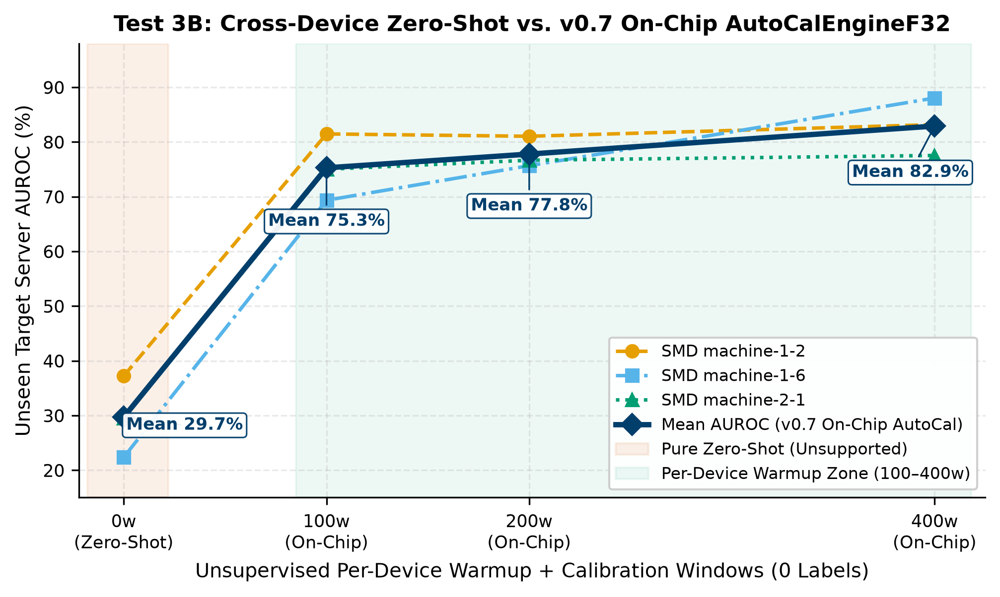

# PPC-Gauge-Triad v0.7.0 (`ppc_gauge_triad_rs`)

[](https://github.com/Imlevion/ppc-gauge-triad/actions/workflows/ci.yml)
[](https://crates.io/crates/ppc_gauge_triad_rs)
[](https://docs.rs/ppc_gauge_triad_rs)
[](LICENSE-MIT)

Deterministic, zero-heap (`#![no_std]`), zero-matrix-inversion Rust (`f32`) streaming anomaly engine with an on-chip Zero-Touch Auto-Warmup state machine (`AutoCalBufF32`: `Warmup -> Calibrate -> Monitor`) for multi-channel telemetry and embedded physical sensors ($X_t \in \mathbb{R}^{w \times d}$, default $w=8, d=4$).

### Visual Benchmark Highlights (Verified Offline Level 2 Replay)


*Figure 1 — Real-world 8-server chronological replay (SMD + PSM, locked a priori presets): **v0.7 High-Recall** reaches **78.7%** mean AUROC and **v0.7 Low-FAR** reaches **77.1%** mean AUROC at **7.6%** mean FAR, ahead of classical batch baselines (Raw kNN `74.9%`, IsoForest `74.0%`, OC-SVM `71.8%`) with `0 B` heap and `0` matrix inversions.*


*Figure 2 — v0.7 On-Chip Zero-Touch Auto-Warmup (`AutoCalEngineF32`, **14,744 B / 14.40 KB** static SRAM on ARM Cortex-M4F): pure zero-shot cross-device transfer is unsupported (**29.7%** mean AUROC), whereas unsupervised on-chip `Warmup -> Calibrate -> Monitor` (`100–400` normal windows, `0` labels) recovers **75.3% → 82.9%** mean AUROC.*

> Reproduce all publication figures (`fig1`, `fig2`, and `fig3` 50k-window Dual-Stage Alarm Gate FAR reduction `10.44% -> 0.30%`) locally via `python benchmarks/generate_paper_figures.py --offline`.

## Validation Status

- **Level 1 (Algorithmic Invariants):** **9 / 9 PASSED** — verified via local `cargo test` (`tests/level1_invariants.rs`, `tests/autocal_v07.rs`) and Python L1.8 parity suite (`benchmarks/test_local_suite.py`).
- **Level 2 (Software & Real-World Benchmarks):** **VERIFIED** — 5/5 cross-compile targets, 8 real servers (SMD + PSM), OpenML physical/trajectory benchmarks, 50,000-window 5-seed streaming, cross-device auto-warmup curve (including v0.7 on-chip `AutoCalEngineF32`: `~14.4 KB` total static SRAM `< 16 KB`, `0 B` heap, `0` matrix inversions).
- **Level 3 (Physical Hardware Verification):** **PENDING** — physical MCU/FPGA silicon cycle counts, `.map` flash/RAM measurements, and mW power profiling are not claimed until measured directly on hardware (`probe-rs` / DWT / power profiler).

See [`VALIDATION_REPORT_v061.md`](VALIDATION_REPORT_v061.md) for the complete evidence table and [`AGENTS.md`](AGENTS.md) for strict engineering rules and roadmap milestones.

---

## Architecture Highlights

1. **`s_shape` (Canonical Shape):** Orthonormal temporal DCT-II projection + explicit $2 \times 2$ Givens-QR canonicalization on $Sim^+(d)$ ($\det = +1$), scored via a symmetrized $K$-prototype rank-1 Sherman-Morrison precision bank ($K \le 4$, `0` matrix inversions, `0` stored training samples).
2. **Orthogonal PCA Residual Feature (`3PC + 1 Residual Norm`):** Maps high-dimensional telemetry ($D > 4$, e.g. 38-channel servers) into $d=4$ with `0` extra struct SRAM by placing the standardized orthogonal residual norm in channel 4.
3. **`s_energy` & `s_level` (Dual-Mode Environmental Tracking):**
   - **Server Telemetry Mode (`huber_clip > 0`):** Huber-clamped EMA tracks slow normal drift without swallowing sustained 50–300 window incidents.
   - **Thermal / Sensor Chip Mode (`huber_clip = 0, dc_relock = 6`):** Fast ramp EMA + 3-window energy hysteresis + stable-plateau DC re-lock.
4. **Dual-Stage Alarm Gate (`step_v61`):** Immediate trip on severe faults (`> 2.5x thr`) OR 2-consecutive-window confirmation.
5. **On-Chip Zero-Touch Auto-Warmup (`AutoCalBufF32` / `AutoCalEngineF32` — v0.7):** Fixed-size `#![no_std]` state machine (`Warmup -> Calibrate -> Monitor`, `MAX_CAL = 256`) that computes split-conformal thresholds and log1p-MAD triad normalizers directly on chip (`~14.4 KB` combined SRAM, enforced `< 16 KB` at compile time, `0 B` heap).

### Locked Operational Presets (Zero Post-Hoc Tuning)

| Preset | `e_alpha` | `dc_alpha` | `huber_clip` | `dc_relock` | Intended Use |
| :--- | :---: | :---: | :---: | :---: | :--- |
| **High-Recall / Max-AUROC** | `0.002` | `0.001` | `1.0` | `0` | Server telemetry screening (`3PC+Resid`) |
| **Low-FAR Monitoring** | `0.008` | `0.004` | `1.5` | `0` | Low-alert-fatigue server monitoring (`3PC+Resid`) |
| **Thermal / Sensor Chip** | `0.20` | `0.25` | `0.0` | `6` | Embedded sensors under thermal ramps & regime steps |

> **Important Design Requirement:** Pure zero-shot cross-device transfer is **not** claimed (`29.7%` mean AUROC across heterogeneous servers). Unsupervised per-device warmup (`100–400` normal windows, zero labels) is required and recovers `75.3%–82.9%` mean AUROC.

---

## Local Verification (No Colab Required)

### 1. Rust Level 1 Invariant Suite (`cargo test`)

```bash
# Fast Level 1 suite (L1.1–L1.8 + 20k-window L1.9 + embedded SRAM & v0.6.1 mode checks)
cargo test

# Full Level 1 suite including 1,000,000-window live online stability (L1.9, ~3–6s)
cargo test --release -- --include-ignored

# Verify #![no_std] release compilation & ARM Cortex-M4F target
cargo check --release --no-default-features --lib
cargo rustc --release --no-default-features --target thumbv7em-none-eabihf --lib --crate-type rlib

# Run Criterion host CPU micro-benchmarks
cargo bench --bench triad_bench
```

### 2. Local Python Benchmark Harness with SMD/PSM Disk Cache

Install minimal Python dependencies (`numpy` and `scikit-learn`; `pandas` is not required):

```bash
pip install -r requirements.txt
```

Run automated Python verification (L1.8 Python NumPy vs Rust `cdylib` parity, SRAM check, cache tests):

```bash
python -m unittest discover -s benchmarks -p "test_*.py" -v
```

Download and cache SMD (7 machines) + PSM (eBay) locally into `data_cache/*.npz` (downloaded once, loaded offline afterward):

```bash
# Populate local .npz cache
python benchmarks/run_benchmarks.py --cache-only

# Run full local benchmark suite offline (L1.8 parity + 8-server ablation + Test 3 warmup curve + host latency)
python benchmarks/run_benchmarks.py --all --offline
```

---

## Repository Layout

```text
├── Cargo.toml                         # crates.io-ready manifest (MIT OR Apache-2.0, #![no_std])
├── CITATION.cff                       # CFF 1.2.0 citation metadata (GitHub "Cite this repository")
├── LICENSE-MIT / LICENSE-APACHE       # Dual open-source licenses
├── CHANGELOG.md                       # Versioned release notes (v0.6.1 -> v0.7.0)
├── src/lib.rs                         # Core GaugeTriadEngineF32, v0.7 AutoCalBufF32/AutoCalEngineF32 & C FFI
├── include/ppc_gauge_triad.h          # Official C99 / C++ ABI header matching Rust #[repr(C)]
├── examples/
│   ├── c_stream_demo.c                # Zero-heap C99 streaming & ABI verification demo
│   └── level3_cortex_m4f_eval_template.rs  # ARM Cortex-M4F DWT cycle-counter eval template (Level 3 PENDING)
├── tests/
│   ├── level1_invariants.rs           # Local Rust Level 1 invariant (L1.1–L1.9) & embedded constraint tests
│   └── autocal_v07.rs                 # v0.7 on-chip AutoCalBufF32 state machine, SRAM & FFI parity tests
├── benches/triad_bench.rs             # Criterion host CPU micro-benchmarks
├── benchmarks/
│   ├── ppc_triad_wrapper.py           # Cross-platform ctypes wrapper + pure-NumPy L1.8 reference
│   ├── dataset_cache.py               # Atomic local .npz cache for SMD & PSM (no pandas)
│   ├── run_benchmarks.py              # Local CLI replacing Google Colab
│   ├── generate_paper_figures.py      # 300-DPI publication figure generator from offline cache
│   └── test_local_suite.py            # Automated unittest/pytest suite
├── paper/
│   ├── ppc_gauge_triad.tex            # arXiv / IEEE preprint manuscript (100% evidence-aligned)
│   └── figures/                       # 300-DPI PNG/PDF figures + JSON metrics provenance
├── .github/workflows/ci.yml           # CI: Rustdoc, doctests, Level 1, C99 demo, cargo package, 5-target matrix
├── notebooks/                         # Historical Colab verification notebook
├── AGENTS.md                          # Engineering constraints & roadmap
└── VALIDATION_REPORT_v061.md          # Complete v0.6.1 validation evidence
```
